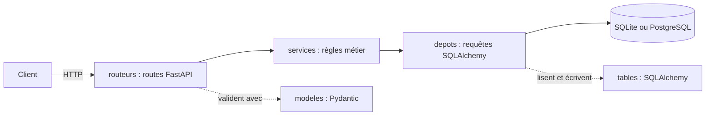

# API Jeux

API REST d'un catalogue de jeux vidéo, écrite avec FastAPI : consulter les jeux et les éditeurs, et les gérer avec un compte. Elle sert le front du catalogue et ses outils d'administration.

## Prérequis

- Python 3.12 ou plus récent (la CI utilise 3.12 ; testé aussi avec 3.14)
- Git
- Aucune base à installer : en développement, l'API utilise SQLite, un simple fichier `jeux.db`.

## Démarrage rapide

```bash
git clone https://github.com/packo-dev/Trav.-collab.-doc.-technique.git api-jeux
cd api-jeux
python -m venv .venv
source .venv/bin/activate          # Windows : .venv\Scripts\activate
pip install -r requirements-dev.txt
cp .env.example .env               # Windows : copy .env.example .env
```

Sous Windows, si PowerShell refuse l'activation (« l'exécution de scripts est désactivée »), tapez `Set-ExecutionPolicy -Scope Process Bypass`, puis relancez l'activation. Le réglage ne vaut que pour ce terminal.

Ouvrez `.env` et modifiez ces trois lignes :

```
DATABASE_URL=sqlite:///./jeux.db
CLE_SECRETE=remplacez-moi
ORIGINES_AUTORISEES=["http://localhost:5173"]
```

Pour `CLE_SECRETE`, générez votre propre clé avec `python -c "import secrets; print(secrets.token_urlsafe(32))"` et collez-la. `ORIGINES_AUTORISEES` doit être écrite entre crochets et guillemets, comme ci-dessus : sous la forme `http://localhost:5173` du fichier d'exemple, l'API refuse de démarrer (`SettingsError: error parsing value for field "origines_autorisees"`).

Puis :

```bash
python scripts/peupler.py          # catalogue de démo (8 jeux) et compte admin@example.com / motdepasse123
fastapi dev app/main.py
```

`peupler.py` affiche `Jeux créés : 8`. Ouvrez http://127.0.0.1:8000/docs : la liste des routes s'affiche.

## Configuration

Les variables se lisent dans `.env` (voir `.env.example`) ou dans l'environnement. Elles sont définies dans `app/config.py`.

| Variable | Rôle | Obligatoire | Valeur par défaut |
|---|---|---|---|
| `DATABASE_URL` | Adresse de la base : `sqlite:///./jeux.db` en développement, `postgresql+psycopg://…` avec PostgreSQL | oui | — |
| `CLE_SECRETE` | Clé qui signe les jetons de connexion. Qui la détient peut forger un jeton d'administrateur : une clé différente par environnement, jamais commitée | oui | — |
| `ALGORITHME_JETON` | Algorithme de signature des jetons | non | `HS256` |
| `DUREE_JETON_MINUTES` | Durée de validité d'un jeton | non | `30` |
| `ORIGINES_AUTORISEES` | Origines du front autorisées (CORS), en liste JSON | non | `["http://localhost:5173"]` |
| `ENVIRONNEMENT` | `developpement` ou `production` | non | `developpement` |
| `NIVEAU_JOURNAL` | Niveau des journaux : `DEBUG`, `INFO`, `WARNING`… | non | `INFO` |
| `ECHO_SQL` | `true` affiche chaque requête SQL dans le terminal | non | `false` |
| `MAX_TENTATIVES_CONNEXION` | Échecs de connexion tolérés avant blocage | non | `5` |
| `FENETRE_TENTATIVES_MINUTES` | Fenêtre de temps où ces échecs sont comptés | non | `15` |

Sans `DATABASE_URL` ou `CLE_SECRETE`, l'API refuse de démarrer, avec `Field required` sur la variable manquante.

## Utilisation

La documentation complète et interactive des routes est générée par FastAPI : http://127.0.0.1:8000/docs. Toutes les routes sont préfixées par `/api/v1`.

Lister les jeux :

```bash
curl http://127.0.0.1:8000/api/v1/jeux
```

Réponse : une page JSON, `{"elements":[{"id":4,"titre":"Among Us",…}],"total":8,…}`.

Se connecter, pour les routes qui modifient le catalogue :

```bash
curl -X POST http://127.0.0.1:8000/api/v1/connexion -d "username=admin@example.com&password=motdepasse123"
```

Réponse : `{"access_token":"…","token_type":"bearer"}`. Le jeton s'envoie ensuite dans l'en-tête `Authorization: Bearer <jeton>`. Dans `/docs`, le bouton **Authorize** fait la même chose.

Lire un jeu :

```bash
curl http://127.0.0.1:8000/api/v1/jeux/1
```

Réponse : la fiche complète de Hollow Knight, avec son éditeur.

## Tests

```bash
pytest
ruff check .
```

`pytest` se termine par une ligne du type `142 passed`, sans `failed`. `ruff check .` affiche `All checks passed!`. La CI (`.github/workflows/verifications.yml`) lance les deux sur chaque pull request.

## Architecture

Une requête traverse quatre couches, toujours dans le même sens :



Un service n'importe jamais FastAPI, et seuls les dépôts écrivent du SQL : `tests/test_architecture.py` le vérifie.

| Dossier | Contenu |
|---|---|
| `app/routeurs/` | Les routes HTTP, un fichier par domaine (jeux, éditeurs, utilisateurs, authentification…) |
| `app/services/` | Les règles métier : vérifications, droits, erreurs applicatives |
| `app/depots/` | L'accès aux données : les seules requêtes SQLAlchemy du projet |
| `app/modeles/` | Les modèles Pydantic : la forme de ce qui entre dans l'API et en sort |
| `app/tables/` | Les modèles SQLAlchemy : les tables de la base |
| `app/main.py` | L'assemblage : configuration, middlewares, gestion des erreurs, routeurs |

Hors de `app/` : `scripts/` (peupler, importer, exporter la base), `tests/`, `donnees/` (le catalogue CSV).

## Contribuer

1. Chaque changement part d'une issue.
2. Partez d'un `main` à jour (`git switch main`, puis `git pull`) et créez une branche `type/numero-description`, par exemple `fix/1-statistiques-catalogue-vide`.
3. Commits au format Conventional Commits : `fix(jeux): …`, `docs: …`, avec `Refs #numero`.
4. Ouvrez une pull request avec `Closes #numero`, et demandez une relecture à un autre membre.
5. Après approbation et CI verte, fusion par **Squash and merge**, puis suppression de la branche.

On ne pousse jamais directement sur `main`.
